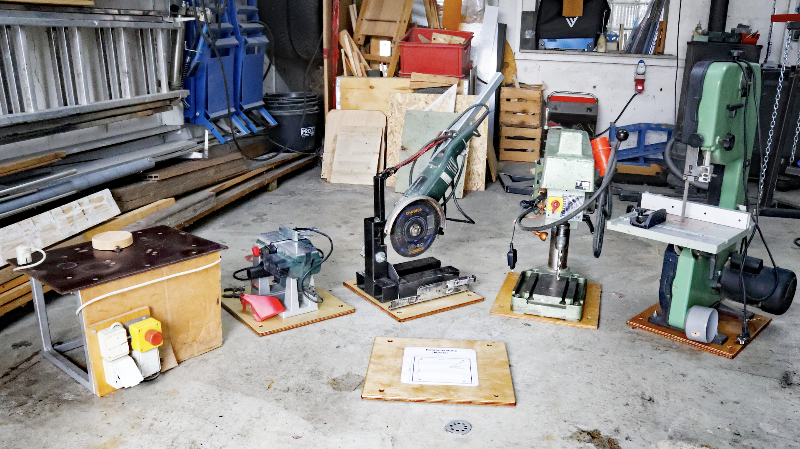

Maker Media GmbH

***

# Platzmanagement für Maschinen

**Wer nicht jeder Maschine einen festen Platz in der Werkstatt geben kann, muss die Geräte häufig tauschen. Damit dieser Wechsel schneller von der Hand geht, habe ich mir ein Adapterplatten-System einfallen lassen.**

Hier liegt die Grafik der Bohrschablone aus dem Artikel.

Der vollständige Artikel zum Projekt steht in der **[Make-Ausgabe 6/26](https://www.heise.de/select/make/2026/6)**.
